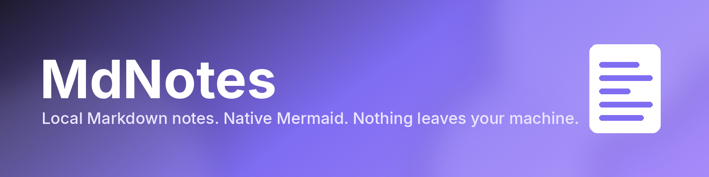
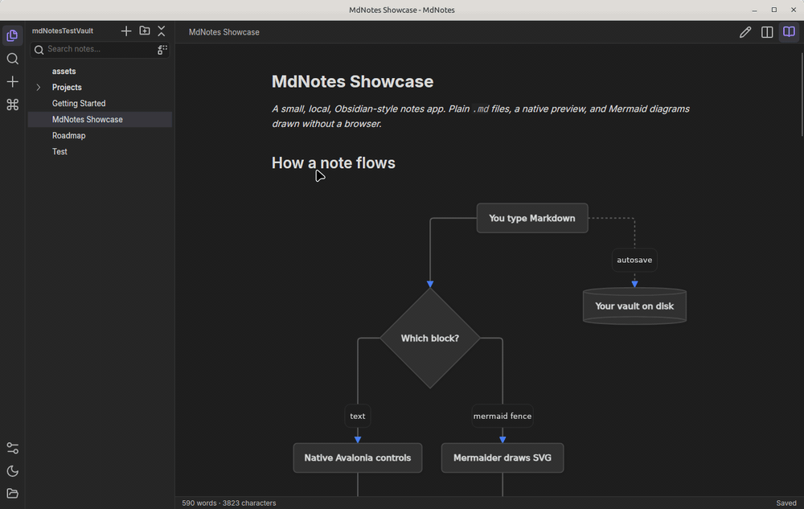

A small, local, Obsidian-style notes app for Windows, macOS and Linux. Notes are plain `.md` files in a
folder of your choice (the "vault"). Nothing leaves your machine, and there is no embedded browser.



## Features

- Edit / Split / Reading views (`Ctrl+E`) with a live, natively rendered preview
- Mermaid diagrams drawn natively — flowchart, sequence, class, state, ER, gantt, pie, mindmap and more
- `[[Wikilinks]]` to notes and `[[Folder/]]` links to folders
- Quick switcher (`Ctrl+O`), accent-insensitive full-text search, vault-wide search and replace (`Ctrl+Shift+H`)
- Drag-to-reorder sidebar, stored in plain `.order` files beside your notes
- Configurable autosave, new-note templates, declared titles and a `.mdnotesignore` — Settings (`Ctrl+,`)
- Opens loose `.md` files, so MdNotes can be your default Markdown handler
- System / Light / Dark theme; the tree follows changes made outside the app

How each of these works is in [docs/FEATURES.md](docs/FEATURES.md).

## Download

Prebuilt builds for Windows and Linux (x64) are on the
[Releases](https://github.com/neisep/MdNotes/releases) page. They need nothing else installed.

- **Linux:** `mdnotes-linux-x86_64.tar.gz`, compiled ahead of time (Native AOT) for a fast start.
  It needs glibc 2.34 or newer (Ubuntu 22.04, Debian 12, Fedora 35 or later). Unpack it and run `MdNotes`:
  `tar -xzf mdnotes-linux-x86_64.tar.gz && ./mdnotes-linux-x86_64/MdNotes`.
- **Windows:** `mdnotes-windows-x86_64.exe`, a single executable.
  `mdnotes-windows-x86_64-aot.zip` is an experimental Native AOT build that starts faster: unpack the
  whole folder and run `MdNotes.exe`. The builds are not signed, so SmartScreen may ask before the
  first start.
- **macOS:** build from source as described below.

## Run

Requires the .NET 10 SDK.

```
dotnet run --project MdNotes                 # asks for a vault folder on first start
dotnet run --project MdNotes -- README.md    # opens a single file
```

## Build a standalone executable

```
dotnet publish MdNotes -c Release -r <rid> --self-contained -p:PublishSingleFile=true -p:IncludeNativeLibrariesForSelfExtract=true
```

`<rid>` is `win-x64`, `linux-x64` or `osx-arm64`. The output is a single executable with no runtime
dependencies (the `.pdb` files next to it can be deleted).

Or compile ahead of time with Native AOT, which starts faster and is smaller, but must be built on the
target OS (on Linux it needs `clang` and `zlib1g-dev`). Keep the native libraries next to the executable:

```
dotnet publish MdNotes -c Release -r <rid> -p:PublishAot=true
```

## Test

```
dotnet test
```

## Stack

.NET 10 / Avalonia 12 / Fluent theme with custom palette / MVVM (CommunityToolkit.Mvvm). Markdig parses markdown and the preview is built from its syntax tree as native controls. Mermaider renders Mermaid to SVG, drawn with Svg.Skia.

## Credits

Inter font (OFL, `MdNotes/Assets/Fonts/OFL.txt`) and Lucide icons (ISC, `MdNotes/Assets/LUCIDE-LICENSE.txt`).
